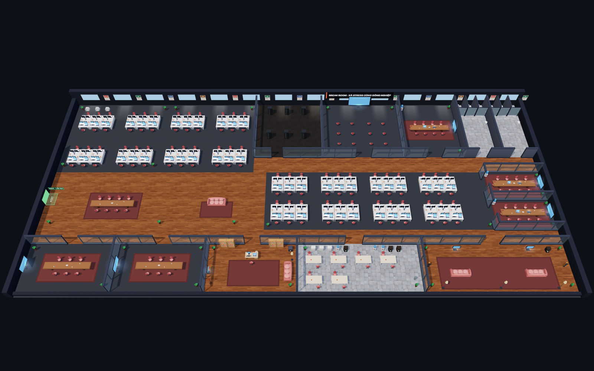

# Break Room

English · [Tiếng Việt](README.vi.md) · [Documentation](docs/README.md)

A multiplayer 3D office-smashing game built with three.js. Smash furniture with colleagues, compete on the damage board or team up against VKL, TML and DMM. IT replaces broken objects in 25–60 seconds depending on players and broken items; Call IT restores everything immediately.



## Run locally

Requires Node.js 20+ and a browser with WebGL.

```bash
npm install
npm start
```

Open http://localhost:3000. One local process needs no Redis; RAM state resets on restart. Multiple instances and Vercel need Redis: see [Deployment](docs/DEPLOYMENT.md).

## Play together

Pick the same **BR-1** or **BR-2** server (20 players each), then share its link. Enter a name and choose a role and appearance. On phones, use the joystick and rotate to landscape.

| Action | Controls |
| --- | --- |
| Move | WASD / arrows; joystick on touch screens |
| Smash | Hold Space; hold SMASH! on touch screens |
| Skill / ultimate | 1, 2, 3 / R; Skill / ULTI buttons |
| Call IT | I |
| Chat / emoji | Enter or `/` / Shift + 1…8 |
| Camera / mini map | Scroll, pinch, +/− / M |

## Tests

```bash
npm test
npm run test:redis
```

`npm test` may skip Redis when `redis-server` is unavailable; a `SKIP` is not Redis validation. `test:redis` uses a temporary podman/docker Redis container for the full suite. [Details](docs/DEVELOPMENT.md).

## Documentation

- [Gameplay](docs/GAMEPLAY.md) — controls, mana, boss, map.
- [Deployment and operations](docs/DEPLOYMENT.md) — Vercel, Redis, env, health checks.
- [Architecture](docs/ARCHITECTURE.md) — store, pub/sub, lifecycle.
- [Development](docs/DEVELOPMENT.md) — code, tests, rendering.
- [ADR](docs/adr/README.md) — architecture decisions and their rationale.
- [Mobile](docs/MOBILE.md) — viewport, gestures and device verification.

## License and credits

Code: [MIT](LICENSE). Floor textures: [ambientCG](https://ambientcg.com/), CC0 ([notice](public/assets/textures/License.txt)). Three.js: MIT ([license](public/vendor/three-LICENSE.txt)). Icons: [Lucide](https://lucide.dev), ISC/MIT ([license](public/vendor/lucide-LICENSE.txt)). Furniture and characters are built in code.

Optional Google login saves a separate character per room; guests remain available. Scores are not saved long-term. [Identity setup](docs/IDENTITY.md).
