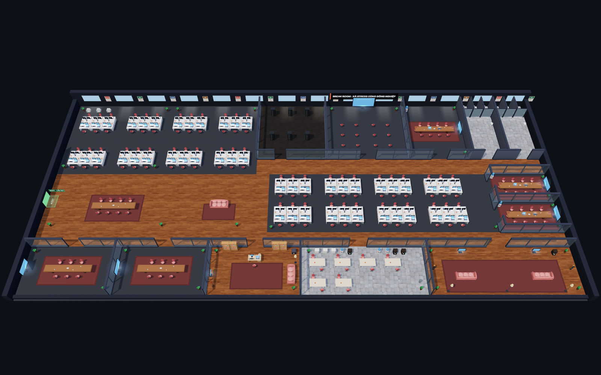

# Break Room

[English](README.md) · Tiếng Việt · [Tài liệu](docs/README.md)

Văn phòng đập phá nhiều người chơi, dựng 3D bằng three.js. Đập đồ cùng đồng nghiệp, đua tổng thiệt hại hoặc hợp sức đánh VKL, TML và DMM. IT tự thay đồ trong 25–60 giây tùy số người và số đồ vỡ; nút Gọi IT thay hết ngay.



## Chạy local

Cần Node.js 20+ và trình duyệt có WebGL.

```bash
npm install
npm start
```

Mở http://localhost:3000. Chạy một tiến trình không cần Redis; state trong RAM mất khi restart. Chạy nhiều instance hoặc deploy Vercel cần Redis: xem [Deploy](docs/DEPLOYMENT.vi.md).

## Chơi chung

Chọn cùng **BR-1** hoặc **BR-2**, tối đa 20 người mỗi server, rồi dùng nút copy link để mời đồng nghiệp. Nhập tên, chọn vai trò và diện mạo; trên điện thoại dùng joystick và xoay máy sang ngang.

| Hành động | Điều khiển |
| --- | --- |
| Di chuyển | WASD / mũi tên; joystick trên màn hình cảm ứng |
| Đập | Giữ Space; giữ nút ĐẬP! trên màn hình cảm ứng |
| Skill / ulti | 1, 2, 3 / R; nút Skill / ULTI |
| Gọi IT | I |
| Chat / emoji | Enter hoặc `/` / Shift + 1…8 |
| Camera / bản đồ | Lăn chuột, chụm hai ngón, +/− / M |

## Kiểm tra

```bash
npm test
npm run test:redis
npm run test:scores   # BXH ngày + lịch sử chat, Postgres/Redis dùng-một-lần
```

`npm test` có thể bỏ qua Redis nếu máy không có `redis-server`; dòng `SKIP` không phải là đã kiểm tra Redis. `test:redis` dùng container Redis tạm qua podman/docker và chạy đầy đủ. [Chi tiết](docs/DEVELOPMENT.vi.md).

## Tài liệu

- [Hướng dẫn chơi](docs/GAMEPLAY.vi.md) — controls, mana, boss, map.
- [Deploy và vận hành](docs/DEPLOYMENT.vi.md) — Vercel, Redis, env, health checks.
- [Kiến trúc](docs/ARCHITECTURE.vi.md) — store, pub/sub, lifecycle.
- [Phát triển](docs/DEVELOPMENT.vi.md) — code, tests, rendering.
- [ADR](docs/adr/README.md) — quyết định kiến trúc và lý do.
- [BXH ngày và lịch sử chat](docs/SCORES.vi.md) — bảng ngày, lưu Postgres, job maintenance.
- [Mobile](docs/MOBILE.md) — viewport, thao tác và kiểm tra thiết bị (tiếng Anh).

## Giấy phép và credits

Code: [MIT](LICENSE). Texture sàn: [ambientCG](https://ambientcg.com/), CC0 ([ghi chú](public/assets/textures/License.txt)). Three.js: MIT ([giấy phép](public/vendor/three-LICENSE.txt)). Icons: [Lucide](https://lucide.dev), ISC/MIT ([giấy phép](public/vendor/lucide-LICENSE.txt)). Đồ đạc và nhân vật dựng bằng code.

Google login tùy chọn lưu nhân vật riêng từng phòng; vẫn vào chơi được không cần đăng nhập. Khi có database, BXH là bảng xếp hạng ngày theo từng phòng (về 0 lúc 00:00 giờ Việt Nam, không có BXH all-time) và chat phòng được giữ 24 giờ; không có lịch sử điểm dài hạn. [Cấu hình identity](docs/IDENTITY.vi.md) · [BXH ngày](docs/SCORES.vi.md).
